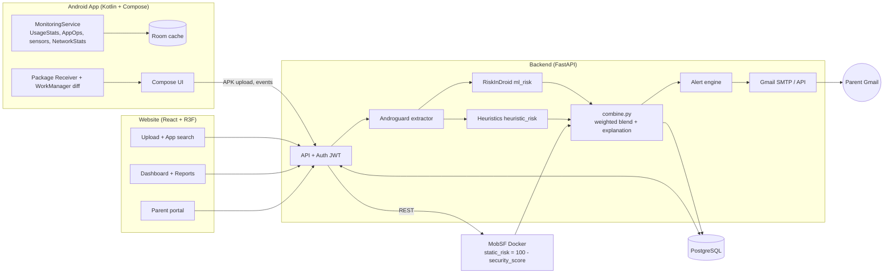
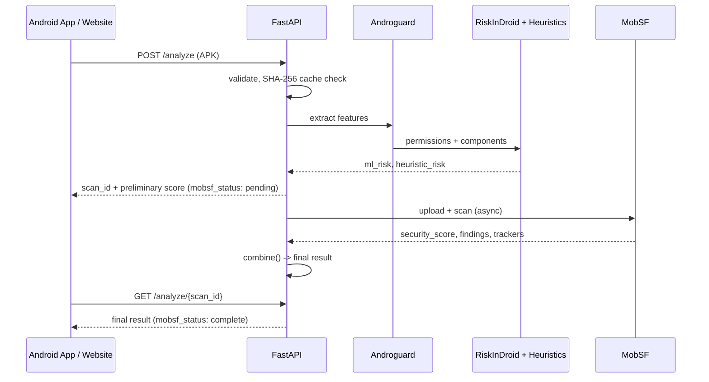
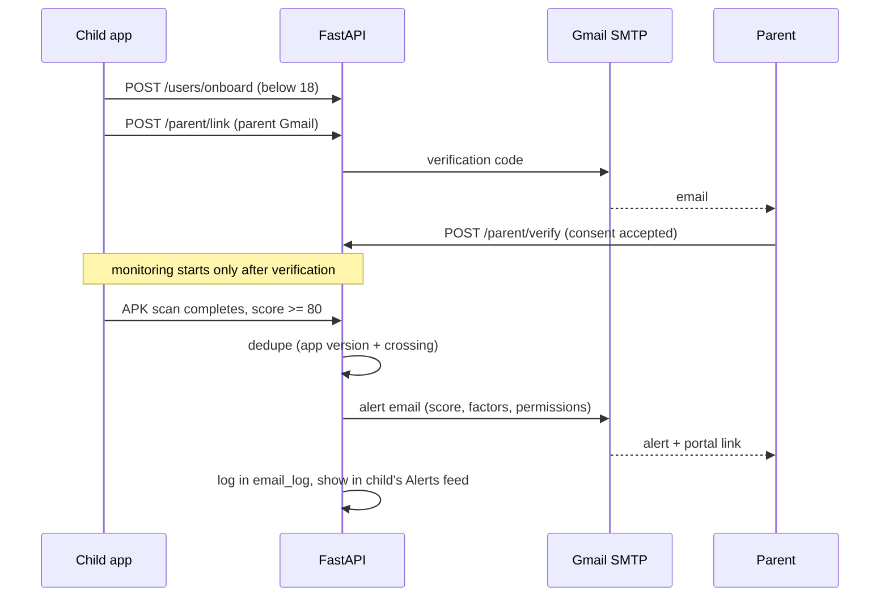

# PrivacyGuard v2: Architecture and Implementation Guide

Explainable Android privacy auditing and monitoring platform ("Understand Before You Trust").
Team "Shadow", HackBIOS. Higher score = higher privacy risk everywhere.

---

## 1. System Architecture



### Score engine (already built)

```text
APK -> Androguard (permissions, declared vs used, components, flags)
   |-> RiskInDroid  -> ml_risk        (0-100)
   |-> Heuristics   -> heuristic_risk (0-100)
   |-> MobSF REST   -> static_risk = 100 - mobsf_security_score
   -> combine(): weights 0.40 ml / 0.35 static / 0.25 heuristic
      (renormalized if a component is missing)
   -> score, severity, breakdown, top_factors, trackers, summary
```

Severity bands: low < 30, medium < 55, high < 80, critical >= 80 (critical = parent alert threshold).

---

## 2. Key Flows

### 2.1 Scan flow (preliminary then final)



### 2.2 Under-18 parent alert flow



---

## 3. Repository Structure

```text
privacyguard/
  backend/
    app/
      main.py            # routes
      config.py          # env, weights, thresholds
      extractor.py       # Androguard
      ml_model.py        # RiskInDroid wrapper
      heuristics.py
      mobsf_client.py
      combine.py         # final blend (provided)
      alerts.py          # threshold + dedupe + email
      mailer.py
      models.py, schemas.py, db.py
    migrations/ (Alembic)
    tests/
    Dockerfile, docker-compose.yml, .env.example
  web/
    src/ (pages, components, three/, api/, charts/)
  android/
    app/src/main/java/.../ (receiver, service, data, ui, net)
  README.md
```

---

## 4. Data Model (PostgreSQL)

| Table | Purpose |
|---|---|
| users | id, display_name, age_category (adult / minor), dob_flag, created_at |
| devices | id, user_id, model, android_version, last_seen |
| apps | id, package, name, version, apk_sha256 |
| scans | id, app_id, device_id, final_score, severity, mobsf_status, complete, created_at |
| scan_components | scan_id, component (ml / heuristic / static), value, weight, status |
| permission_events | device_id, package, permission, state (observed / inferred / declared), fg_bg, ts |
| usage_events | device_id, package, event (resumed / paused / fg_service), ts |
| network_stats | device_id, package, fg_bytes, bg_bytes, window_start |
| alerts | id, user_id, scan_id, kind, created_at |
| parent_links | user_id, parent_email, verified_at, consent_version |
| email_log | alert_id, to, status, attempts, sent_at |

---

## 5. API Reference (target)

| Method | Path | Purpose |
|---|---|---|
| POST | /analyze | Upload APK, returns scan_id + preliminary result |
| GET | /analyze/{scan_id} | Poll; same shape preliminary and final |
| GET | /apps/search?q= | Real app search (listing/Data Safety + stored audits) |
| POST | /devices/register | Register device |
| POST | /devices/{id}/events | Batch usage, sensor, network events |
| POST | /users/onboard | Age category |
| POST | /parent/link, /parent/verify | Consent-first parent linking |
| GET | /parent/portal/{token} | Parent view (expiring magic link) |
| GET | /alerts | Alert feed |
| GET | /reports/{scan_id} | PDF / JSON export |
| GET | /health | Androguard, model, MobSF, DB, SMTP status |

Unified result shape (from `combine.py`): `score, severity, breakdown{ml,static,heuristic}, top_factors[], trackers[], summary, mobsf_status, complete`.

---

## 6. Android Monitoring Signals (what is really possible)

| Signal | API | Needs | Confidence label |
|---|---|---|---|
| New install / update | PACKAGE_ADDED receiver + WorkManager diff | QUERY_ALL_PACKAGES | Observed |
| Foreground/background timeline | UsageStatsManager.queryEvents | Usage Access | Observed |
| Granted permissions | PackageManager + AppOpsManager mode | none | Declared |
| Microphone active | AudioManager recording callback | none | Inferred (correlated with foreground app) |
| Camera active | CameraManager.AvailabilityCallback | none | Inferred |
| Location use | granted state + foreground app | none | Declared / Inferred |
| Background data | NetworkStatsManager | Usage Access | Observed |
| Exact per-app access history | AppOps history | Shizuku / ADB grant (optional mode) | Observed |

Never claim exact per-app permission access logs in standard mode.

---

## 7. Implementation Phases

### Phase 0: Plan
- [ ] Read existing backend; list real endpoints and JSON shapes (this is the API contract)
- [ ] Confirm component output keys match `combine()` inputs
- [ ] Verify MobSF score direction on a real APK

### Phase 1: Backend
- [ ] `combine.py` wired into `/analyze` (preliminary then final)
- [ ] SHA-256 cache, APK validation, async MobSF task
- [ ] PostgreSQL schema + Alembic, JWT auth
- [ ] Device/event endpoints, search endpoint
- [ ] Age category, parent link/verify, alert rule (>= 80, deduped), Gmail sender with retry
- [ ] `/health`, tests, docker-compose (engine + MobSF + PostgreSQL)
- [ ] Verify: real APK in, real unified result out; MobSF down still returns a score

### Phase 2: Website
- [ ] API client generated from real backend schemas
- [ ] Upload + live scan pipeline view, score breakdown charts, permission analysis
- [ ] App search, dashboard, reports, parent portal, privacy policy
- [ ] 3D landing (R3F), reduced-motion fallback, lazy-loaded 3D
- [ ] Empty / loading / error states everywhere (no mock data)

### Phase 3: Android app
- [ ] Onboarding: age category, consent, Usage Access flow
- [ ] Receiver + WorkManager fallback, APK upload with consent, Room cache
- [ ] MonitoringService (foreground notification), usage/sensor/network collectors
- [ ] App detail: breakdown, permissions, fg vs bg timeline, confidence labels
- [ ] Alerts feed, parent link UI, "Parental alerts enabled" indicator, delete my data
- [ ] Gradle build passes; test on a real phone

### Phase 4: Hardening and demo
- [ ] Pre-pull MobSF image, pre-scan demo apps so results are cached
- [ ] Test: safe app, risky app, simple app give clearly different scores
- [ ] Test: under-18 flow end to end with a real parent Gmail
- [ ] Rehearse the 3-minute demo

---

## 8. Environment Variables

```text
DATABASE_URL=postgresql://...
JWT_SECRET=...
MOBSF_URL=http://mobsf:8000
MOBSF_API_KEY=...
SMTP_USER=...
SMTP_APP_PASSWORD=...          # Google app password (needs 2-step verification)
PARENT_ALERT_THRESHOLD=80
WEIGHT_ML=0.40
WEIGHT_STATIC=0.35
WEIGHT_HEURISTIC=0.25
MAX_APK_MB=150
```

---

## 9. Privacy and Safety Rules

- Explicit consent before APK upload and before sharing with a parent.
- Shared with parent: app name, audit score, severity, key flagged permissions, timestamp. Not shared: messages, photos, browsing, app content, location history.
- Persistent notification and a visible parental-alert indicator; no hidden monitoring.
- Age category is self-declared (state this limitation).
- "Delete my data" in app and website; privacy policy page.
- APKs are analyzed as data only, never executed; temp files cleaned up.

## 10. Known Limits (state these in the demo)

- Standard-mode Android cannot read another app's exact permission-access history; labels show Observed / Inferred / Declared.
- QUERY_ALL_PACKAGES is restricted on Google Play (fine for a hackathon APK).
- MobSF scans can be slow; the preliminary score appears first.
- MobSF is GPLv3: use it only through its REST API as a separate service.
